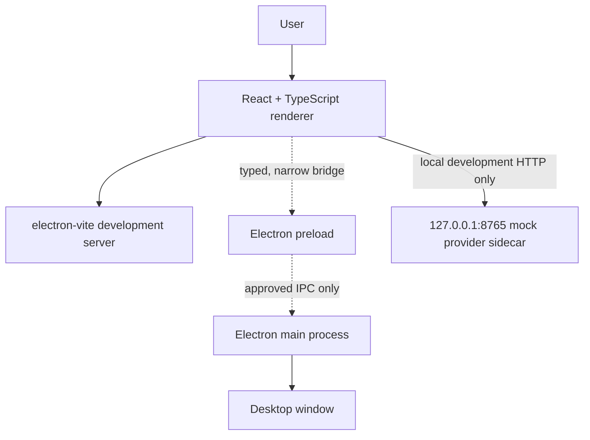
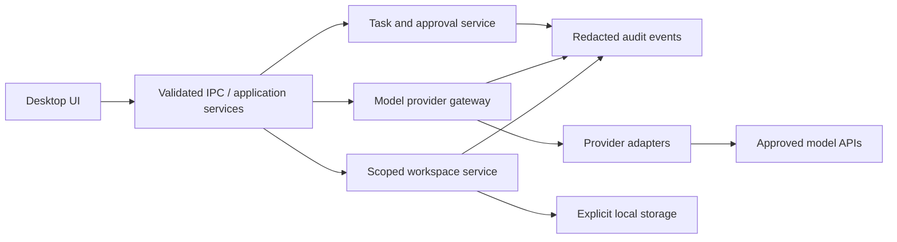

# Architecture Notes

## Scope

This document distinguishes the current desktop UI shell from proposed future modules. It is not a declaration that all boxes below are implemented.

## Current local application

The renderer can call the local Python sidecar for health checks, echo tests, a deterministic mock-provider chat route, and bounded read-only literal search of eligible text/code files under the repository root. Search skips common generated/dependency folders and secret-like files and does not persist an index. The app does not currently call an external AI model, run commands, use the camera/microphone or persist AI memory.

## Proposed future boundaries

## Boundary rules

### Renderer

- Treat user input and all model output as untrusted.
- Render model text as text by default; sanitize/limit any rich content renderer.
- Do not access Node APIs or secrets directly.
- Show connection, loading, failure and permission state clearly.

### Preload and IPC

- Keep `contextIsolation` enabled and `nodeIntegration` disabled.
- Export only the minimum typed methods needed by the renderer.
- Validate payload shape, sizes and allowed operation names on the receiving side.
- Do not expose arbitrary filesystem or shell functions.

### Workspace and tool execution (planned)

- Scope file access to user-selected project roots.
- Show path, proposed change and diff before applying a change.
- Require explicit user approval before shell/process execution.
- Use timeouts, output limits, cancellation and auditable outcomes.

### AI providers (planned)

- Keep provider implementations behind a typed adapter interface.
- Store keys outside source control and never send secrets to the renderer unless absolutely required by an explicit, reviewed design.
- Handle timeouts, rate limits, cancellation, malformed responses and provider errors.
- Do not imply a model response is verified fact or successful execution.

### Memory and device features (planned)

- Make memory inspectable, editable and deletable, with a clear retention policy.
- Attribute retrieved knowledge to its source.
- Request camera/microphone access only after an explicit feature action, show a clear active indicator and provide a reliable off switch.

## DIS AI platform integration

Integration with the separate DIS AI repository must begin with inspection of the real backend routes, authentication model, data contracts and error semantics. Use a mock adapter while that contract is being verified. Do not guess or hard-code API endpoints from diagrams.
